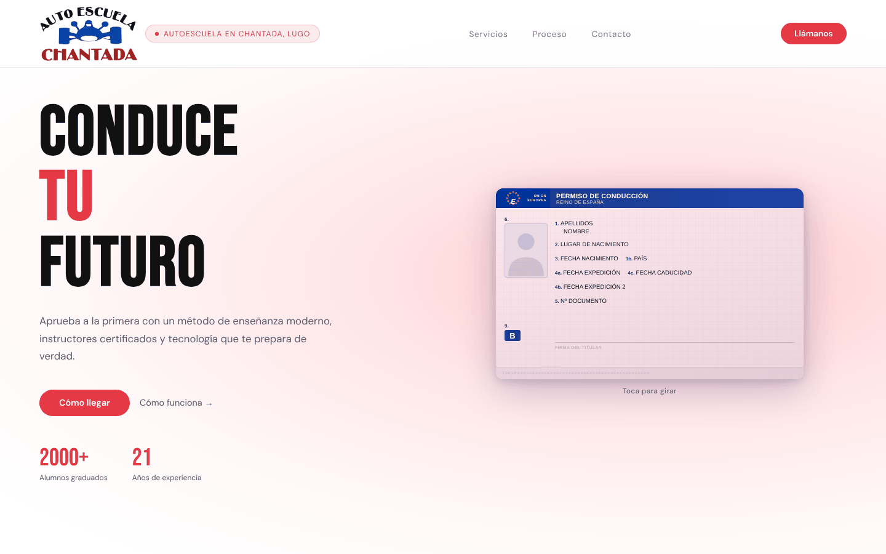
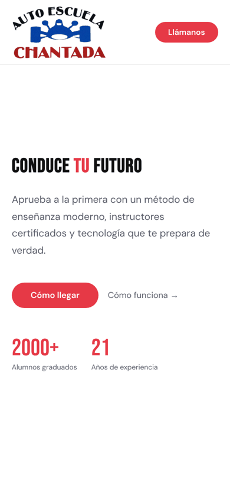

<div align="center">

# 🚦 Autoescuela Chantada · Sitio web

**Web corporativa de una autoescuela real de Chantada (Lugo), en producción.**

### 🌐 [autoescuelachantada.com](https://www.autoescuelachantada.com/)


&nbsp;&nbsp;

</div>

---

## Sobre el proyecto

Diseñé y desarrollé esta web para la autoescuela de mi familia. El objetivo es que cualquier persona de la zona encuentre en un minuto lo que necesita para sacarse el carnet: qué permisos se imparten, cómo es el proceso, cómo contactar y dónde está la autoescuela.

Es un proyecto con un **cliente real**: la desarrollé a partir de sus necesidades y está **publicada y en uso** con dominio propio.

## Funcionalidades

- **Portada** con propuesta de valor, cifras de la autoescuela y llamadas a la acción para llamar o ver cómo llegar.
- **Servicios**: carnet B, permisos A1 y A2, test online y clases de reciclaje.
- **Proceso en 4 pasos**, desde la primera clase hasta el examen.
- **Opiniones** de alumnos.
- **Contacto** con teléfono, email, horario y enlace a Google Maps.
- **Diseño responsive**, adaptado a móvil, tablet y escritorio.
- **Animaciones al hacer scroll** con `IntersectionObserver`, sin librerías externas.
- **Páginas legales**: aviso legal, política de privacidad y política de cookies.
- **SEO**: metadatos, `sitemap.xml` generado automáticamente y páginas prerenderizadas como estáticas.

## Stack tecnológico

| Área | Tecnologías |
|---|---|
| **Framework** | Next.js 16 (App Router) con generación estática |
| **UI** | React 19, componentes propios |
| **Lenguajes** | TypeScript y JavaScript (JSX) |
| **Estilos** | CSS propio con variables y media queries, sin frameworks |
| **Calidad** | ESLint con la configuración de Next.js (Core Web Vitals) |
| **Analítica** | Cloudflare Web Analytics, sin cookies |

## Estructura

```
autoescuela_chantada/
├── app/
│   ├── layout.tsx           Layout raíz y metadatos
│   ├── page.tsx             Portada
│   ├── sitemap.ts           Sitemap generado automáticamente
│   ├── aviso-legal/         Página legal
│   ├── privacidad/          Política de privacidad
│   └── cookies/             Política de cookies
├── components/              Secciones de la portada
│   ├── Navbar.jsx
│   ├── Hero.jsx
│   ├── CarnetConducir.jsx   Carnet de conducir ilustrado en SVG
│   ├── Servicios.jsx
│   ├── Proceso.jsx
│   ├── Testimonios.jsx
│   ├── CTA.jsx
│   └── Contacto.jsx
├── public/                  Recursos estáticos
└── docs/screenshots/        Capturas del README
```

## Ejecutar en local

Requisitos: **Node.js 20** o superior.

```bash
git clone https://github.com/martinglopez/autoescuela_chantada.git
cd autoescuela_chantada
npm install
npm run dev
```

La web queda disponible en `http://localhost:3000`.

| Comando | Descripción |
|---|---|
| `npm run dev` | Servidor de desarrollo con recarga en caliente |
| `npm run build` | Compilación de producción |
| `npm run start` | Sirve la compilación de producción |
| `npm run lint` | Análisis estático con ESLint |

---

<div align="center">

Desarrollado por **Martín García López** · [LinkedIn](https://www.linkedin.com/in/mmartinglopez)

</div>
